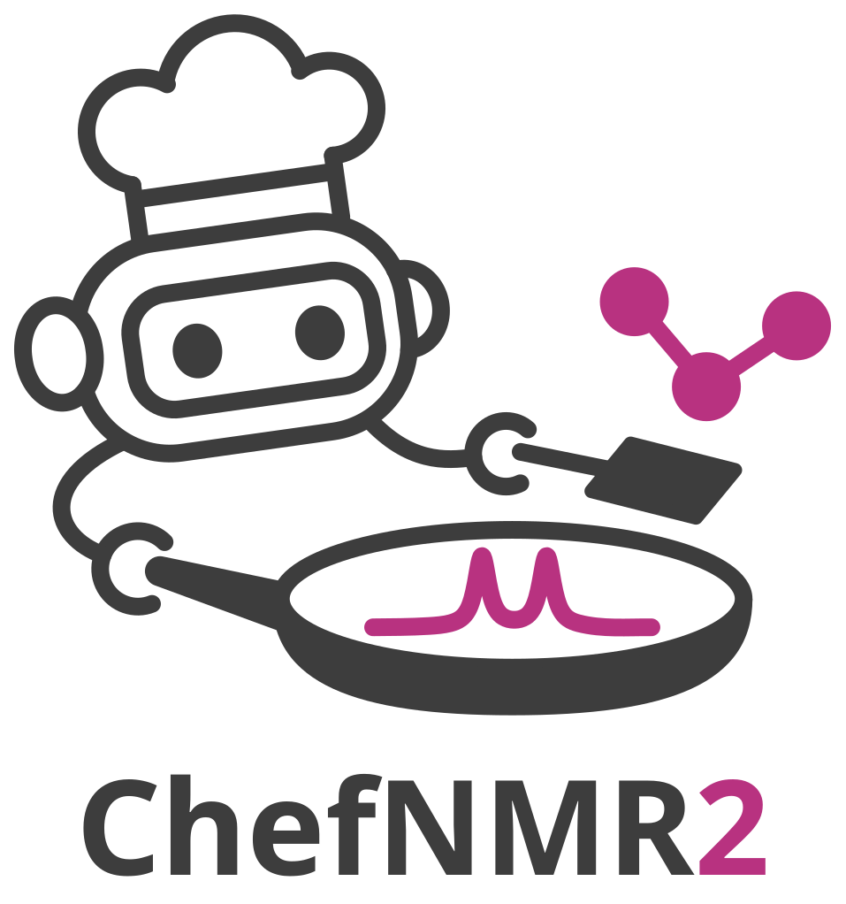
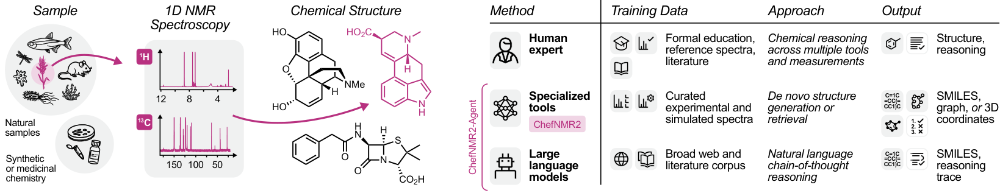

<p align="center">
  <picture>
    <source media="(prefers-color-scheme: dark)" srcset="assets/chefnmr2-logo-dark.svg">
    
  </picture>
</p>

[Preprint](https://doi.org/10.64898/2026.10.29.762711) · [Project page](https://chefnmr.cs.princeton.edu) · [Web app](https://huggingface.co/spaces/ziyux123/chefnmr2) · [Weights](https://huggingface.co/ziyux123/chefnmr2)

ChefNMR2 elucidates the structure of a small molecule from its 1H and 13C NMR peak lists and molecular
formula.

<p align="center"></p>

This repository holds ChefNMR2's inference code; the training code and training data follow with the journal
publication.

## How to use

- **ChefNMR2**
  - **Try it online**: run ChefNMR2 in the browser with the [Web app](https://huggingface.co/spaces/ziyux123/chefnmr2),
    with no install, or connect it to an AI chat app such as Claude through the MCP address
    `https://ziyux123-chefnmr2.hf.space/gradio_api/mcp/`; the web app shows the steps.
  - **Install and run locally**: install ChefNMR2, download the paper's checkpoints from Hugging Face and
    elucidate a structure, as the sections below show.
- **ChefNMR2-Agent**: coming soon.

## Install

Python 3.11 on Linux.

```bash
git clone https://github.com/ml-struct-bio/chefnmr2
cd chefnmr2
pip install .
python -c "from chefnmr2.infer import ChefNMR2, Peaks; print('ok')"
```

`pip install .` takes PyTorch 2.5.1 from PyPI (with CUDA 12 on Linux). For a CPU-only machine,
install the CPU wheel first: `pip install torch==2.5.1 --index-url https://download.pytorch.org/whl/cpu`.

## Checkpoints

The 10 checkpoints of the paper's model (one training run, epochs 949 to 1399 every 50) are on Hugging
Face, in the model repository `ziyux123/chefnmr2`. Each folder holds `model.pt` (fp32, 1.15 GB),
`config.yaml` and `manifest.json` (the sha256 of `model.pt` and `config.yaml`). Download them (11.5 GB)
into `checkpoints/`; this and the commands below run from the repository's folder:

<!-- not run: a download; the checks place these files themselves -->
```bash
pip install huggingface_hub
hf download ziyux123/chefnmr2 --revision 38a741cce3e6f7e0d5a827a66f8d3dea0728daf5 --local-dir checkpoints
```

Then check every file against its folder's `manifest.json`:

```python
import hashlib
import json
from pathlib import Path

folders = sorted(p for p in Path("checkpoints").iterdir() if (p / "manifest.json").is_file())
bad = []
for d in folders:
    for name, f in json.loads((d / "manifest.json").read_text())["files"].items():
        h = hashlib.sha256()
        with open(d / name, "rb") as fh:
            for chunk in iter(lambda: fh.read(1 << 24), b""):
                h.update(chunk)
        if h.hexdigest() != f["sha256"]:
            bad.append(f"{d.name}/{name}")
print(f"{len(folders)} checkpoints, sha256 checked: {'all match' if not bad else bad}")
```

```text
10 checkpoints, sha256 checked: all match
```

## Quickstart

Elucidate one molecule and read the answer. Elucidate morphine from its peak lists:

```python
import json
from pathlib import Path

import torch
from chefnmr2.infer import ChefNMR2, Peaks

members = [(d.name, d / "model.pt", d / "config.yaml") for d in sorted(Path("checkpoints").glob("chefnmr2-epoch*"))]
model = ChefNMR2(members, device="cuda" if torch.cuda.is_available() else "cpu")

peaks = Peaks(
    c=[145.2, 138.0, 133.2, 130.9, 128.5, 126.6, 120.2, 116.8, 91.9,
       66.6, 59.1, 46.6, 43.3, 43.1, 40.7, 35.6, 20.7],
    h=[(6.63, 1, "d"), (6.5, 1, "d"), (5.67, 1, "dddd"), (5.28, 1, "ddd"),
       (4.89, 1, "dd"), (4.2, 1, "ddd"), (3.41, 1, "dd"), (3.03, 1, "d"),
       (2.73, 1, "m"), (2.66, 1, "dd"), (2.47, 3, "s"), (2.45, 1, "td"),
       (2.33, 1, "dd"), (2.12, 1, "td"), (1.88, 1, "ddd")],
)
out = model.elucidate(peaks, formula="C17H19NO3", n_samples=100, seed=0)
print(json.dumps(out["candidates"], indent=1))
```

Expected output (on an NVIDIA H100 GPU):

<!-- output: gpu only -->
```text
[
 {
  "smiles": "CN1CCC23c4c5ccc(O)c4OC2C(O)C=CC3C1C5",
  "votes": 94,
  "vote_fraction": 0.9895
 },
 {
  "smiles": "CN1CCC23C4=CCC(O)C2Oc2c(O)ccc(c23)CC41",
  "votes": 1,
  "vote_fraction": 0.0105
 }
]
```

- Input:
  - `peaks`: the 13C shifts in ppm, and the 1H peaks as (shift in ppm, number of protons, multiplicity).
  - `formula`: the molecular formula, with hydrogens.
  - `n_samples`: how many samples to draw.
    - A number, such as `n_samples=100` above: the samples are split evenly over the checkpoints (10 each here).
    - `"adaptive"`: sample as the paper does: 100 samples first, then 1,000 or 3,000 in total when they do not
      agree on one structure (Methods); the answer's `n_samples` gives the number drawn.
  - `seed`: the random seed.
- Output: `candidates`, the structures the samples gave, ranked by sampling frequency.
  - `smiles`: the structure.
  - `votes`: the number of samples that gave it.
  - `vote_fraction`: its sampling frequency.

Accuracy metric: the paper reports top-k accuracy, the share of molecules whose reported structure is among
the first k candidates; `match_smiles` decides whether a candidate is the reported structure (the same planar
structure, stereochemistry ignored).

<!-- continues: the Quickstart -->
```python
from chefnmr2.chem.match import match_smiles

reported = "CN1CC[C@]23c4c5ccc(O)c4O[C@H]2[C@@H](O)C=C[C@H]3[C@H]1C5"  # morphine, as reported
hits = [match_smiles(reported, c["smiles"]) for c in out["candidates"]]
print({f"top-{k}": any(hits[:k]) for k in (1, 3, 10)})
```

```text
{'top-1': True, 'top-3': True, 'top-10': True}
```

Time for this call (PyTorch 2.5.1):

| hardware | load the 10 checkpoints | `elucidate` (100 samples) |
|---|--:|--:|
| NVIDIA H100 80GB HBM3 (CUDA 12.4) | 14.6 to 15.1 s | 5.7 to 6.9 s |
| NVIDIA A100-SXM4-80GB (CUDA 12.4) | 16.1 s | 9.7 to 11.0 s |
| 16 CPU threads (Intel Xeon Platinum 8462Y+ or AMD EPYC 7413) | 14.4 to 17.2 s | 74.4 to 178.3 s |

## Test sets

Run ChefNMR2 on the paper's test sets: `data/` holds them as used in the study, one file per set, with
each molecule's formula, peak lists and reported structure.

- [data/README.md](data/README.md) lists the files, their fields, their sources and the licence of each file.
- A row's `c` and `h` go into `Peaks` as they are: `Peaks(c=row["c"], h=[tuple(p) for p in row["h"]])`.
- Reproduce ChefNMR2's results on one file: the command below runs every row with `n_samples="adaptive"`
  and prints top-1 to top-10 accuracy by `match_smiles`. On one NVIDIA A100 GPU it takes about 45 min for
  `specteach.jsonl` and about 3 h for `nmrshiftdb2.jsonl`.

<!-- not run: hours on a GPU -->
```bash
python -m chefnmr2.eval.accuracy data/specteach.jsonl --checkpoints checkpoints
```

## Citation

Cite the preprint (also in [CITATION.cff](CITATION.cff)):

```bibtex
@article{xiong2026chefnmr2,
  title   = {Small molecule structure elucidation from NMR spectra with generative and reasoning models},
  author  = {Xiong, Ziyu and Ying, Vanessa Y. and Huang, Jonathan Z. and Koch, Zane and Clark, Joseph D. and Heeter, Robert C. and An, Joon Soo and Matanachai, Karit and Rodriques, Samuel G. and White, Andrew D. and Seyedsayamdost, Mohammad R. and Zhong, Ellen D.},
  journal = {bioRxiv},
  year    = {2026},
  doi     = {10.64898/2026.10.29.762711}
}
```

## Licence

- The code is under the MIT License ([LICENSE](LICENSE)); third-party code and its licences are in
  [THIRD_PARTY.md](THIRD_PARTY.md).
- The checkpoints are under the Community Data License Agreement – Sharing 1.0 (CDLA-Sharing-1.0).
- The checkpoints were trained on data that include structures from NPAtlas and NP-MRD (CC BY-NC 4.0);
  check those terms before any commercial use.
